# EAP — Dissertação: assistente conversacional para o Adhara QBank

A EAP está orientada aos entregáveis. No nível 1, cada elemento é um entregável do projeto; no nível 2, os pacotes de trabalho que o compõem. O âmbito de cada elemento é a soma do âmbito dos seus filhos, e o que não está na EAP fica fora do âmbito.

- **PREPD (laranja):** 1.1 Documento de PREPD e 1.2 Revisão sistemática. Não envolvem a Adhara nem desenvolvimento.
- **DIMEI (azul):** 1.3 a 1.8. Começa depois da revisão sistemática.

A numeração não indica a ordem temporal; a ordem fica no cronograma. A abordagem é híbrida: o âmbito é planeado à partida, e a implementação (1.6) decorre em incrementos. A análise experimental (1.4) escolhe o modelo, o *prompt* e os campos do contexto, que se mantêm até ao fim; a implementação (1.6) usa essa escolha e não a repete; a avaliação (1.5) avalia essa escolha com especialistas e utilizadores.

Ficheiro fonte: [eap.puml](eap.puml).

```plantuml
@startwbs eap
' EAP (WBS) da dissertação — orientada a entregáveis
' Unidades curriculares: PREPD = 1.1 e 1.2 (laranja); DIMEI = 1.3 a 1.8 (azul)
<style>
wbsDiagram {
  FontName Arial
  FontSize 12
  LineColor #64748B
  RoundCorner 6
  Padding 6
  :depth(0) {
    BackgroundColor #17324D
    LineColor #17324D
    FontColor #FFFFFF
    FontStyle bold
    FontSize 14
  }
  :depth(1) {
    BackgroundColor #DCEBFF
    LineColor #5B8FD6
    FontStyle bold
  }
  :depth(2) {
    BackgroundColor #F4F6F9
    LineColor #8A94A3
  }
  .prepd {
    BackgroundColor #FFE7C2
    LineColor #E0A040
  }
  .dimei {
    BackgroundColor #DCEBFF
    LineColor #5B8FD6
  }
  .uc {
    LineColor transparent
    BackgroundColor transparent
    FontSize 15
    FontStyle bold
    FontColor #555555
  }
}
</style>

* Dissertação: assistente conversacional\npara o Adhara QBank

**_ PREPD <<uc>>
** 1.1 Documento de PREPD <<prepd>>
*** 1.1.1 Problema, objetivos e questões\nde investigação
*** 1.1.2 Proposta metodológica\ne de avaliação
*** 1.1.3 Planeamento\n(EAP e cronograma)
*** 1.1.4 Extended abstract
*** 1.1.5 Documento final
*** 1.1.6 Apresentação

** 1.2 Revisão sistemática\nda literatura <<prepd>>
*** 1.2.1 Protocolo da revisão
*** 1.2.2 Pesquisa e seleção (PRISMA)
*** 1.2.3 Avaliação da qualidade
*** 1.2.4 Extração e síntese
*** 1.2.5 Lacuna de investigação

**_ DIMEI <<uc>>
** 1.3 Requisitos <<dimei>>
*** 1.3.1 Levantamento com a Adhara
*** 1.3.2 Requisitos funcionais\ne não funcionais
*** 1.3.3 Critérios de aceitação\ne de sucesso

** 1.4 Análise experimental\nde LLM <<dimei>>
*** 1.4.1 Modelos candidatos\n(API e locais)
*** 1.4.2 Conjunto de teste
*** 1.4.3 Prompt e campos\ndo contexto
*** 1.4.4 Resultados comparativos
*** 1.4.5 Escolha do modelo\ne da configuração

** 1.5 Avaliação <<dimei>>
*** 1.5.1 Avaliação por especialistas
*** 1.5.2 Questionário a utilizadores
*** 1.5.3 Latência e custo em uso
*** 1.5.4 Análise de resultados

** 1.6 Assistente\nimplementado <<dimei>>
*** 1.6.1 Arquitetura e integração\nno QBank
*** 1.6.2 Interface de conversa
*** 1.6.3 Serviço de conversa\ne ligação ao LLM
*** 1.6.4 Segurança e privacidade
*** 1.6.5 Funcionalidades extra\npedidas pela Adhara

** 1.7 Verificação\ne testes <<dimei>>
*** 1.7.1 Testes unitários\ne de componentes
*** 1.7.2 Testes de integração\ne de sistema
*** 1.7.3 Testes de âmbito\ne de segurança
*** 1.7.4 Testes de aceitação

** 1.8 Dissertação <<dimei>>
*** 1.8.1 Documento da dissertação
*** 1.8.2 Versão final submetida
*** 1.8.3 Apresentação da defesa
@endwbs
```

# Dicionário da EAP

**Regra de progresso:** cada pacote de trabalho segue a regra 0/100 — só conta quando o entregável existe e cumpre os critérios de aceitação. O progresso de um elemento do nível 1 é a soma das percentagens dos pacotes concluídos.

| Código | Tipo | Descrição e critérios de aceitação | Critérios de progresso |
|---|---|---|---|
| **1.1 Documento de PREPD** | Entregável (PREPD) | Documento final da unidade curricular e respetiva apresentação. **Aceitação:** inclui problema, objetivos, questões de investigação, estado da arte, metodologia, plano (EAP, dicionário e cronograma) e ética; entregue no prazo da UC; apresentação feita. | Problema, objetivos e RQ – 15%; proposta metodológica – 15%; EAP e cronograma – 10%; extended abstract entregue – 15%; documento final entregue – 30%; apresentação feita – 15% |
| **1.2 Revisão sistemática da literatura** | Entregável (PREPD) | Revisão segundo Kitchenham, relatada segundo o PRISMA 2020. **Aceitação:** protocolo documentado; todas as decisões de seleção com critério e motivo registados; contagens do PRISMA coerentes com os registos; cada estudo incluído com pontuação de qualidade; síntese responde à RQ1 e à RQ2; lacuna explícita. | Protocolo – 10%; pesquisa e seleção com PRISMA – 30%; avaliação da qualidade – 15%; extração e síntese – 35%; lacuna – 10% |
| **1.3 Requisitos** | Entregável (DIMEI) | Requisitos do assistente obtidos com a Adhara. **Aceitação:** cada requisito é verificável (sim/não); os critérios de sucesso estão quantificados (por exemplo, latência e custo máximos); a Adhara e o orientador reviram o documento. | Levantamento feito – 30%; requisitos funcionais e não funcionais escritos – 40%; critérios aceites pela Adhara – 30% |
| **1.4 Análise experimental de LLM** | Entregável (DIMEI) | Comparação de modelos (por API e locais), de *prompts* e de campos do contexto (que dados da pergunta o modelo recebe), com perguntas reais do QBank, antes de construir a aplicação. Termina com a escolha do modelo, do *prompt* e do contexto, usados até ao fim. **Aceitação:** pelo menos três modelos testados no mesmo conjunto de teste; conjunto com dúvidas respondíveis, fora do âmbito e de manipulação, em várias línguas; resultados de correção, fidelidade, recusa, latência e custo por modelo; escolha justificada face aos critérios de 1.3. | Modelos candidatos definidos – 10%; conjunto de teste criado – 25%; prompts e campos do contexto definidos – 15%; testes executados e resultados registados – 35%; escolha documentada – 15% |
| **1.5 Avaliação** | Entregável (DIMEI) | Avaliação do modelo e da configuração escolhidos em 1.4, já no assistente, com especialistas e utilizadores. Ao contrário de 1.4, não compara modelos: verifica se a escolha cumpre os critérios de sucesso. **Aceitação:** protocolo, amostra e instrumentos descritos; resultados comparados com os critérios de sucesso de 1.3; limitações reportadas; dados pessoais anonimizados. | Especialistas – 30%; questionário – 30%; latência e custo em uso – 15%; análise de resultados – 25% |
| **1.6 Assistente implementado** | Entregável (DIMEI) | Chat integrado no QBank, com o modelo, o *prompt* e o contexto escolhidos em 1.4, entregue em incrementos. Inclui o desenho da arquitetura (componentes e ligação ao QBank) e as funcionalidades extra que a Adhara pedir. **Aceitação:** arquitetura documentada e revista pelo orientador; cada funcionalidade cumpre os requisitos de 1.3 a que está ligada; versão executável integrada no QBank; demonstração feita à Adhara. | Arquitetura e integração – 25%; interface – 15%; serviço de conversa – 25%; segurança e privacidade – 15%; funcionalidades extra – 20% |
| **1.7 Verificação e testes** | Entregável (DIMEI) | Evidência de que a implementação cumpre os requisitos. **Aceitação:** cada requisito tem pelo menos um caso de teste; resultados registados; sem defeitos críticos por resolver. | Unitários e de componentes – 25%; integração e sistema – 25%; âmbito e segurança – 25%; aceitação – 25% |
| **1.8 Dissertação** | Entregável (DIMEI) | Documento final e defesa. **Aceitação:** todos os capítulos completos e revistos pelo orientador; formatação segundo as regras do ISEP; submetida no prazo. | Primeira versão completa – 50%; versão revista submetida – 35%; apresentação da defesa – 15% |
