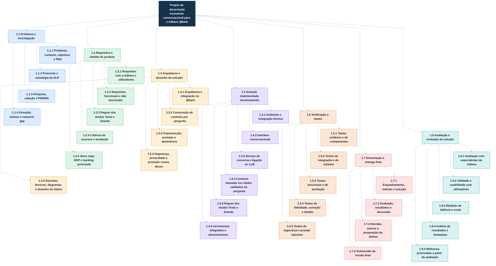

# EAP — Desenvolvimento iterativo da solução

**Tema:** Assistente conversacional baseado em LLM integrado no Adhara QBank, para os modos Teste e Estudo, usando a informação validada associada à pergunta.

> A EAP organiza o âmbito em níveis hierárquicos: o nível 0 liga diretamente a cada pacote 1.x, e cada pacote 1.x liga apenas aos seus próprios subentregáveis 1.x.x. Não há setas visíveis entre pacotes irmãos. As ligações invisíveis `~~~` servem apenas para manter os irmãos alinhados verticalmente; não indicam dependência nem ordem de execução. O número e conteúdo dos incrementos são definidos progressivamente.

# Dicionário da EAP — Desenvolvimento iterativo

## Regras comuns de progresso

- Um pacote de trabalho só é considerado concluído quando o entregável existe e cumpre os critérios de aceitação.
- Para pacotes com vários componentes, registar cada componente como **não iniciado**, **em curso** ou **aceite**. O progresso percentual pode ser calculado como componentes aceites / componentes definidos, sem atribuir pesos arbitrários.
- Em 1.4, medir o progresso por stories aceites face às stories comprometidas em cada incremento. O número e conteúdo dos incrementos são definidos progressivamente.
- Uma demonstração, reunião ou tarefa iniciada não equivale, por si só, a um entregável aceite.

## 1.1 Problema e investigação

**Tipo:** Entregável de investigação  
**Descrição:** Caracterização do problema e do contexto do Adhara QBank, objetivos e perguntas de investigação, protocolo da revisão sistemática, corpus selecionado, extração e síntese da literatura.  
**Inclui:** protocolo e queries; pesquisa nas fontes definidas; critérios de inclusão/exclusão; deduplicação e screening; diagrama PRISMA; avaliação da qualidade; matriz de extração; síntese por RQ e research gap.  
**Critérios de aceitação:** perguntas e protocolo documentados; decisões e contagens da pesquisa rastreáveis; fluxo PRISMA coerente; síntese responde às RQs e fundamenta o espaço para a contribuição.  
**Evidência de conclusão:** protocolo, registo de pesquisa, registo de seleção, PRISMA, avaliação de qualidade, matriz de extração e síntese.

## 1.2 Requisitos e âmbito do produto

**Tipo:** Entregável de requisitos e planeamento  
**Descrição:** Requisitos do assistente obtidos com a Adhara e, quando aplicável, utilizadores; delimitação do MVP para os modos Teste e Estudo. O modo Simulado está fora do âmbito atual.  
**Inclui:** necessidades e atividades; requisitos funcionais e não funcionais; regras sobre revelar ou não a resposta correta por modo; critérios de aceitação e sucesso; story map; MVP, incrementos e backlog no Jira.  
**Critérios de aceitação:** requisitos priorizados e rastreáveis às necessidades; regras por modo explícitas; stories com descrição e critérios de aceitação verificáveis; MVP e dependências revistos com a Adhara/orientador.  
**Evidência de conclusão:** especificação de requisitos, story map e backlog priorizado.

## 1.3 Arquitetura e desenho da solução

**Tipo:** Entregável de arquitetura  
**Descrição:** Desenho da solução e da sua integração com o QBank, incluindo o percurso dos dados desde a pergunta até à resposta do assistente.  
**Inclui:** componentes e interfaces; pontos de integração; construção do contexto apenas com dados validados associados à pergunta (vinheta, opções, catalogação, resposta, explicação, dicas e informação complementar, conforme permitido); gestão da conversa; modelo e configuração; prompts, salvaguardas e abstinência; segurança, privacidade, latência e custo.  
**Critérios de aceitação:** diagramas legíveis e consistentes; fluxos e responsabilidades definidos; limites do contexto e regras Teste/Estudo explícitos; decisões técnicas e riscos registados; desenho revisto com a Adhara/orientador.  
**Evidência de conclusão:** diagramas de arquitetura e sequência/dados, decisões técnicas e especificação do comportamento.

## 1.4 Solução implementada iterativamente

**Tipo:** Solução funcional entregue por incrementos  
**Descrição:** Implementação e integração do chat no Adhara QBank através de incrementos curtos planeados a partir do backlog.  
**Inclui:** ambiente e interfaces de integração; interface de chat; serviço de conversação e ligação ao LLM; obtenção dos dados validados da pergunta; aplicação das regras de Teste e Estudo; tratamento de erros e limites operacionais.  
**Critérios de aceitação:** cada story implementada cumpre os seus critérios; alterações integradas; incremento demonstrável; trabalho e decisões atualizados no backlog. O âmbito dos incrementos pode ser revisto com base no feedback e nos riscos encontrados.  
**Evidência de conclusão:** versão executável integrada, stories aceites e demonstração de cada incremento.

## 1.5 Verificação e testes

**Tipo:** Entregável de verificação  
**Descrição:** Evidência de que a implementação satisfaz os requisitos e trata os riscos técnicos previstos. Esta verificação distingue-se da avaliação da solução com especialistas e utilizadores.  
**Inclui:** testes unitários/de componentes; integração; sistema; critérios de aceitação; casos para fidelidade, correção e respostas fora do âmbito; segurança e prompt injection.  
**Critérios de aceitação:** casos de teste ligados aos requisitos; resultados e defeitos documentados; defeitos críticos resolvidos ou explicitamente registados; comportamento Teste/Estudo verificado.  
**Evidência de conclusão:** plano ou conjunto de casos de teste, resultados, defeitos e estado de resolução.

## 1.6 Avaliação e evolução da solução

**Tipo:** Entregável de avaliação  
**Descrição:** Avaliação da qualidade técnica e do valor de utilização do assistente, seguida da análise e priorização de melhorias.  
**Inclui:** avaliação de respostas por especialistas da Adhara; utilidade e usabilidade com utilizadores através de instrumento definido; latência e custo; análise dos resultados face aos critérios de sucesso; limitações e melhorias.  
**Critérios de aceitação:** protocolo, amostra/instrumentos e métricas descritos; resultados e feedback analisados; limitações reportadas; backlog final repriorizado.  
**Evidência de conclusão:** protocolo e instrumentos, resultados anonimizados quando aplicável, análise e backlog de melhorias.

## 1.7 Dissertação e entrega final

**Tipo:** Entregável académico final  
**Descrição:** Documento final que apresenta problema, revisão da literatura, requisitos, arquitetura, implementação, verificação, avaliação, resultados e limitações.  
**Inclui:** escrita e revisão; referências e anexos; preparação da defesa; submissão.  
**Critérios de aceitação:** conteúdo completo e coerente com o trabalho realizado; método e resultados reproduzíveis quanto possível; revisão final concluída; submissão segundo os requisitos do curso.  
**Evidência de conclusão:** dissertação submetida e materiais de defesa preparados.

## Campos do Jira — definições

- **Prioridade:** ordem de realização no backlog.
- **Valor:** benefício esperado para utilizadores ou para os objetivos da tese.
- **Esforço/dificuldade:** dimensão relativa do trabalho; usar uma escala consistente.
- **Horas:** duração prevista, apenas se necessária para planeamento; não substitui esforço relativo.
- **Critérios de aceitação:** condições observáveis para considerar a story concluída.
- **Dependência:** trabalho ou decisão que tem de estar disponível antes de outra story.
