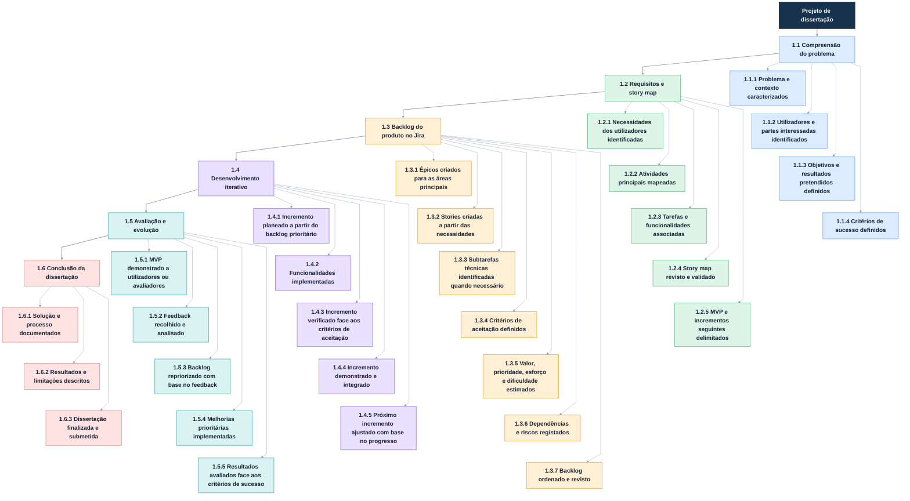

# EAP — Desenvolvimento iterativo da solução

As ligações verticais entre as atividades irmãs servem apenas para manter o desenho compacto; não indicam dependência nem ordem de execução.

> Os incrementos são planeados progressivamente. O respetivo conteúdo pode mudar quando o backlog é revisto após implementação e feedback.
Os incrementos são planeados progressivamente. O respetivo conteúdo pode mudar quando o backlog é revisto após implementação e feedback.